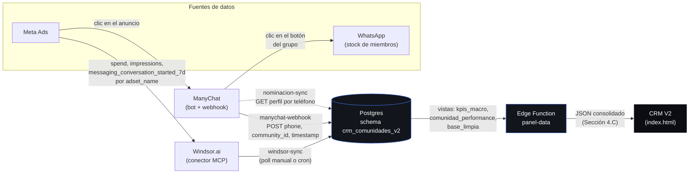

# Arquitectura

Ref: documento de Jaz, Secciones 1-2 ("Alcance, Concepto y Visión Operativa" y "Arquitectura Backend y Motor de Procesamiento").

## Diagrama de integración

## Por qué un backend real y no un Claude Artifact puro

El documento de Jaz pide que el CRM "se despliegue mediante un Claude Artifact / MCP Framework". Un Artifact es una página que corre del lado del cliente, sin backend propio — no puede:

- Recibir el `POST` en vivo que manda ManyChat cuando alguien clickea el botón del grupo (necesita una URL pública siempre corriendo).
- Sondear la API de Windsor.ai por su cuenta (necesitaría exponer la API key en el cliente, y no hay forma de programarlo periódicamente sin un proceso propio).

Por eso el "backend processing engine" de la Sección 1 se construye como Edge Functions de Supabase (Deno) — el mismo patrón ya probado en V1 (`api-publica`, `activacion-manychat`) — y el frontend es una app hosteada normal (Vercel) que consume el endpoint `panel-data`. Ese endpoint queda igual de servible para un Artifact real si se arma uno más adelante: el contrato JSON no cambia según quién lo consuma.

## Componentes

| Componente | Qué hace | Gate si falta la credencial |
|---|---|---|
| `manychat-webhook` | Recibe eventos en vivo → `evento_crudo` | `MANYCHAT_WEBHOOK_SECRET` — 501 |
| `windsor-sync` | Trae spend/impresiones/conversaciones → `meta_ads_metrica` | `WINDSOR_API_KEY` — 501 |
| `nominacion-sync` | Completa nombre/email en `usuario_curado` | `MANYCHAT_API_KEY` — 501 |
| `panel-data` | Arma el JSON consolidado (Sección 4.C) | Ninguna — siempre responde, con ceros si no hay datos |
