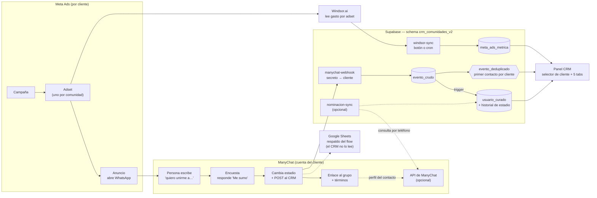

# Flujo de información: de la campaña al panel

Ref: [`specs/2026-09-29-estado-hacia-spec-final.md`](../../specs/2026-09-29-estado-hacia-spec-final.md), secciones 3 bis y 3 ter.

Cada cliente de Taquion tiene su propia cuenta de ManyChat y sus propias comunidades. El CRM es uno solo; el selector de cliente del panel decide qué universo se ve.

## Dónde entra cada conector

| Conector | Dirección | Qué trae | Cuándo corre |
|---|---|---|---|
| Windsor.ai | Meta → Windsor.ai → `windsor-sync` | Gasto, impresiones y conversaciones iniciadas por adset | Botón del panel o cron; Windsor actualiza una vez por día |
| External Request de ManyChat | ManyChat → `manychat-webhook` | El evento de la persona (teléfono, comunidad, momento) | Cada vez que la persona responde "Me sumo" |
| API de ManyChat | `nominacion-sync` → ManyChat | Nombre y email del perfil | Solo si se elige nominación por API (decisión 4 del spec). Requiere una clave por cuenta |

El External Request y la API son cosas distintas: el primero lo dispara ManyChat hacia el CRM; la segunda la consulta el CRM hacia ManyChat.

## Qué viaja en el POST de ManyChat

Verificado en el editor de ManyChat (2026-09-29). El POST manda el objeto "Full Contact Data" del contacto más dos valores fijos (cliente y comunidad).

| Dato | Clave en ManyChat | Qué hace el webhook |
|---|---|---|
| Teléfono | `whatsapp_phone` (formato `+549…`). `phone` y el campo de sistema "Teléfono" llegan `null` | Lo normaliza a solo dígitos y lo usa como identificador de la persona |
| Nombre | `first_name`, `last_name`, `name` | Lo copia al usuario, salvo que sea solo dígitos (contacto sin nombre revelado) |
| Comunidad | Campo personalizado `Localidad_*` (o el valor fijo de la rama) | Busca la comunidad dentro del cliente |
| Mensaje de entrada | `last_input_text` | Queda en el payload |
| Estadio | Campo personalizado `Estado_Comunidad` | Estadio inicial `clic_en_grupo` |
| Identidad alternativa | `whatsapp_bsuid`, `id` (ID de ManyChat) | Quedan en el payload |
| Cliente y secreto | Encabezados `x-cliente` y `x-webhook-secret` | Valida y resuelve el cliente |

`last_interaction` puede venir `null`: el orden del primer contacto se toma de la hora de recepción.

## Estadios de la persona

El estadio vive en `usuario_curado.estado`, por cliente. Cada cambio se registra en `usuario_estado_historial`.

| Estadio | Estado | Quién lo cambia |
|---|---|---|
| Escribió (entró al bot) | Sin registrar todavía como estadio | — |
| `clic_en_grupo` (respondió "Me sumo") | Confirmado por el documento de Jaz | El flow de ManyChat, vía `manychat-webhook` |
| En el grupo | Por definir | ManyChat no reporta la entrada real al grupo |
| Abanderado | Por definir | Por definir |

## Reglas del modelo

- El teléfono identifica a la persona; la atribución es por cliente. La misma persona en dos clientes son dos filas, cada una con su comunidad de origen.
- Una comunidad, un evento y una métrica siempre pertenecen al mismo cliente (FK compuesta).
- El gasto de Meta se asigna a una comunidad por el nombre exacto del adset dentro de ese cliente.
- El selector solo mostrará los clientes habilitados para el usuario (`usuario_cliente`) cuando se active el login (diferido).
