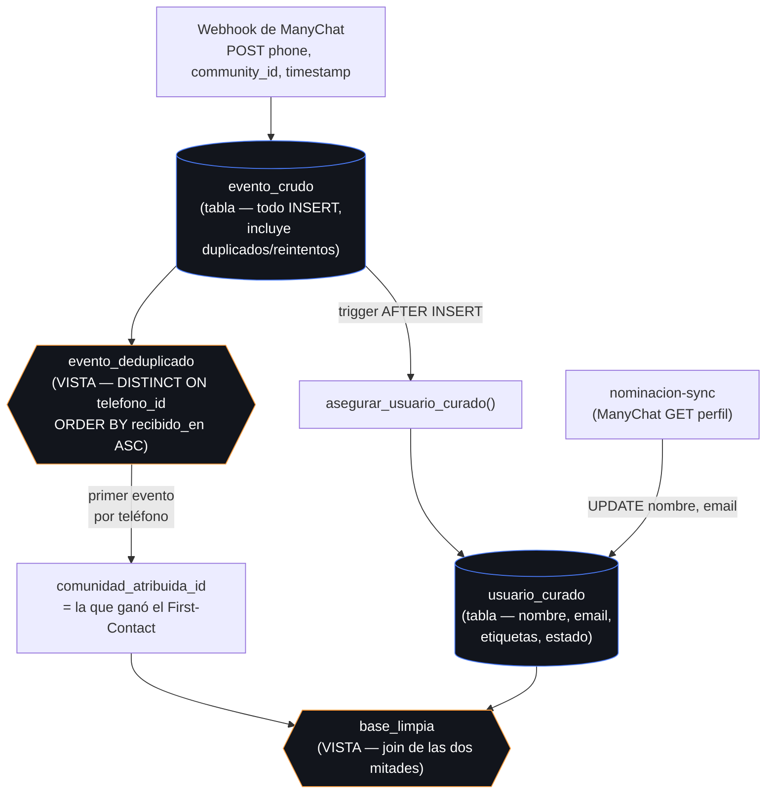

# Modelo de atribución First-Contact

Ref: documento de Jaz, Sección 2 ("Atribución por Primer Contacto: el número de teléfono es la llave primaria. Si un usuario interactúa con múltiples comunidades, el motor le asigna el 100% del origen publicitario a la primera comunidad registrada").

## Diagrama de flujo: Crudo → Deduplicado → Curado

## Por qué la atribución vive solo en una vista

Si el mismo teléfono clickea el link de dos comunidades distintas, `evento_crudo` va a tener dos filas — una por cada clic, en el orden en que realmente llegaron. `evento_deduplicado` recalcula, cada vez que se consulta, cuál de esas filas tiene el `recibido_en` más antiguo, y esa es la comunidad que gana el 100% de la atribución. Nunca se "fija" ese resultado en una columna aparte: si en algún momento se detecta que llegó un evento fuera de orden (por un reintento tardío con un timestamp más viejo), la vista lo refleja automáticamente en la siguiente consulta, sin ninguna migración de datos ni proceso de recálculo.

`usuario_curado`, en cambio, sí es una tabla real — pero guarda únicamente lo que la deduplicación *no puede* saber por sí sola: el nombre y el email reales (que vienen de ManyChat, no del webhook de clics) y el etiquetado manual. Separar las dos cosas evita el problema clásico de tener la misma información en dos lugares que se pueden desincronizar.

## Ejemplo

1. `+5491111111111` clickea el link de la comunidad **San Luis** el lunes a las 10:00 → una fila en `evento_crudo`.
2. El mismo número clickea el link de **Boedo** el miércoles a las 15:00 → segunda fila en `evento_crudo`.
3. `evento_deduplicado` para ese teléfono devuelve la fila del lunes — **San Luis** se queda con el 100% de la atribución publicitaria, aunque el usuario también haya interactuado con Boedo después.
4. `usuario_curado` no tiene ninguna columna que diga "San Luis" — esa respuesta siempre sale de consultar `evento_deduplicado` en el momento.
